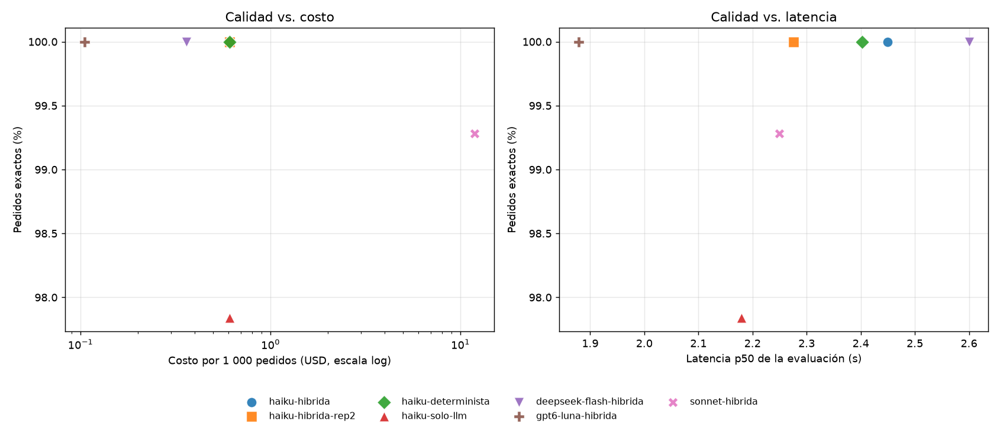

# Análisis de la evaluación y elección del modelo

Reproducir: `uv run python -m novapedidos.evaluacion.comparar` (requiere MLflow y `OPENROUTER_API_KEY`).
Tabla completa: [resultados.md](resultados.md) · datos: [resultados.csv](resultados.csv) · detalle por caso: `detalle/`.
En MLflow: experimento `novapedidos-evaluacion`, filtro `tags.comparacion_final = 'true'`.

## 1. Conjunto de evaluación (132 casos)

| Origen | Casos | Qué cubre |
|---|---|---|
| Publicados (`mensajes_dev.jsonl`) | 84 | Los 12 tipos del catálogo de problemas |
| **Propios** (`evaluacion/casos_propios.jsonl`) | 48 | Lo que los publicados **no** cubren |

Casos propios, por familia (12 c/u): **cantidades** (sueltas no exactas → `cantidad_no_convertible`, que no
aparece en ningún caso publicado; docenas; fracciones; paquetes/sobres; umbrales exactos de descuento),
**habitual y correcciones** ("lo de siempre" con correcciones, exclusiones y sustitutos; correcciones cruzadas en
varios mensajes), **seguridad** (7 inyecciones de instrucciones, 2 con crédito excedido; 5 fuera de alcance nuevos)
y **catálogo/negocio** (variantes que no se venden, ambigüedades nuevas, crédito en el límite exacto, 13:59 vs 14:00,
cambio de año).

**Cómo se construyó la respuesta esperada de los casos propios:** 4 agentes escribieron mensaje + interpretación
según `politicas.md` (`casos_propios_fuente.json`); el motor determinista (verificado contra los 84 publicados)
calculó la respuesta esperada (`construir_casos_propios.py`); 4 verificadores independientes, **sin ver la
interpretación**, recalcularon a mano cada caso desde los parquet: 48/48 correctos, 0 discutibles.

## 2. Calificaciones (scorers por código)

Todas deterministas, gratis y reproducibles (`src/novapedidos/evaluacion/`): `pedido_exacto` (métrica principal:
todo correcto a la vez), `estado_correcto`, `lineas_correctas`, `montos_correctos` (precio, descuento, subtotal),
`total_correcto`, `fecha_correcta`, `motivos_correctos`, `pendientes_correctos` (motivo + opciones; el texto libre no cuenta),
`sustituciones_correctas`, `lineas_f1` (crédito parcial), `contrato_valido` (invariantes del Anexo, sin necesitar
la respuesta correcta), `mensaje_coherente` (§9), y `latencia_s` / `costo_usd` leídos de la traza.

**¿Por qué no un juez LLM?** Lo que el enunciado evalúa (estado, líneas, total, fecha, motivos) tiene una única
respuesta correcta: compararla con código es exacto y gratis. El único texto libre es `mensaje_cliente`, que se
genera con una plantilla a partir del pedido; sus requisitos (§9) se verifican con código.

## 3. Resultados (código final, una corrida por configuración + una repetición)

| Configuración | Exactos | Latencia p50 / p95 | Costo por 1 000 pedidos | Fallas |
|---|---|---|---|---|
| **claude-haiku-5.5 · híbrida** | **132/132 (100 %)** | 2.5 s / 3.7 s | US$0.61 | — |
| claude-haiku-5.5 · híbrida (repetición) | 132/132 (100 %) | 2.4 s / 3.4 s | US$0.61 | — |
| claude-haiku-5.5 · determinista | 132/132 (100 %) | 2.0 s / 3.4 s | US$0.61 | — |
| claude-haiku-5.5 · **solo LLM** | 129/132 (97.7 %) | 2.3 s / 3.4 s | US$0.61 | D008, D014, PA10 |
| deepseek-v4.1-flash · híbrida | 131/132 (99.2 %) | 2.7 s / **5.4 s** | US$0.31 | D025 |
| gpt-6-luna · híbrida | 132/132 (100 %) | **1.8 s** / 3.7 s | **US$0.11** | — |
| claude-sonnet-5.5 · híbrida | 132/132 (100 %) | 2.2 s / 4.0 s | US$12.00 | — |

### Lectura de las fallas

- **Solo LLM (97.7 %)**: el modelo responde "lo que probablemente quiso decir" en vez de "todo lo que podría
  significar": "pasta" sin la pasta dental (D008, D014); y al revés, marcó "frijol negro" como ambiguo con
  el frijol rojo aunque el cliente dijo el color (PA10). Es la razón de
  la estrategia híbrida: **la ambigüedad la decide el código**.
- **deepseek (D025)**: extrajo "lo mismo que la vez pasada" como si fuera un producto → pendiente
  `producto_no_existe` extra (las líneas sí eran correctas).
- **Variabilidad entre corridas**: en una corrida intermedia (no publicada, con el código de ese momento), haiku
  segmentó mal "pasta: 2, seis fardos de espagueti" en D008. Ese caso se interpretó bien en las otras corridas de
  haiku híbrido: con temperatura 0 los modelos no son 100 % deterministas.

### Dentro vs. fuera de muestra (lectura honesta del 100 %)

El 132/132 es exactitud **dentro de la muestra**: los 84 casos publicados se usaron para ajustar el prompt
(v1 → v3, ver DECISIONES D10) y dos casos propios (PA11, PB05) revelaron defectos que se corrigieron. Por eso la
cota "regla del 3" (~2.3 % de error) **no** se puede leer como el error esperado con mensajes nuevos.

| Medición (haiku · híbrida) | Exactos | IC 95 % (Wilson) | Tipo |
|---|---|---|---|
| Prompt v1 sobre los 84 publicados, antes de ajustar | 72/84 = 85.7 % | [76.7 %, 91.6 %] | punto de partida |
| **Primer contacto con los 48 casos propios** (creados después de cerrar el prompt v3; falló PA11) | **47/48 = 97.9 %** | **[89.1 %, 99.6 %]** | **fuera de muestra** |
| Versión final sobre los 132 | 132/132 = 100 % | [97.2 %, 100 %] | dentro de la muestra |

La mejor estimación de lo que verá el docente con mensajes no publicados es la **fuera de muestra (~98 %, con un
intervalo amplio por el tamaño del conjunto)**. Además, las revisiones adversariales de los incisos 4 y 6 (537
menciones y 267 solicitudes generadas por agentes) encontraron fallas en fenómenos que no estaban en ningún caso:
con mensajes realmente nuevos es esperable una tasa de error algo mayor que la medida aquí.

Para **comparar alternativas**, en cambio, todas se midieron sobre los mismos 132 casos: la comparación es
justa entre ellas, y en este conjunto la calidad no distingue a haiku, luna y sonnet; por eso decidieron costo,
latencia y operación.

### Latencia: evaluación vs. servicio

Las latencias de la tabla incluyen la exportación **síncrona** de trazas de la evaluación y 2–4 solicitudes en
paralelo. La latencia del **servicio en Docker**, medida por HTTP (`evidencia/docker/prueba_http.json`), es
menor: **p50 1.3 s, p95 1.8 s** sobre los 132 casos.

## 4. Hallazgos operativos (también son evidencia)

| Hallazgo | Consecuencia en el producto |
|---|---|
| `claude-sonnet-5.5` rechaza `function_calling` (no admite `tool_choice` forzado) | El extractor prueba el otro método de salida estructurada automáticamente |
| `gpt-6-luna` y `claude-sonnet-5.5`: **20 solicitudes/minuto** en cuentas nuevas (429) | Riesgo para un modelo principal bajo la carga de la evaluación |
| Un caso propio (PA11, "72 jaboncitos rosa **sueltos**") reveló que "sueltos" no se reconocía como unidad suelta | Corregido; sin casos propios habría pasado inadvertido |
| Un caso propio (PB05, "de **naranjita** mejor 4") reveló que una corrección ambigua no usaba el contexto | Corregido: correcciones/exclusiones se resuelven con lo ya pedido |

## 5. Evidencia en MLflow (capturas en `evidencia/mlflow/`)

| Captura | Qué muestra |
|---|---|
| `trazas_lista.jpg` | Trazas de solicitudes reales (experimento `novapedidos`): entrada, salida, duración, estado y tokens |
| `traza_detalle_ejemplo_anexo.jpg` | Árbol de spans del ejemplo del Anexo: `interpretar_pedido` → `extraccion` → `ChatOpenAI` (1.8 s, ~US$0.0006) → `resolucion` → `motor_reglas` |
| `comparacion_pedido_exacto.jpg` | Gráfico de MLflow comparando `pedido_exacto` de los 7 runs finales (filtro `tags.comparacion_final = 'true'`) |
| `evaluaciones_historial.jpg` | Historial de **todas** las evaluaciones del experimento `novapedidos-evaluacion`. Las caídas a 0 % y 28.8 % son intentos **descartados** de Sonnet (incompatibilidad de método y límite de 20 solicitudes/min) antes de corregirlos; se conservan como historial. Los resultados publicados son los runs con la etiqueta `comparacion_final` |

Las evaluaciones se ejecutaron contra un MLflow local de desarrollo. El MLflow del `docker compose` arranca vacío:
el experimento `novapedidos-evaluacion` aparece al correr `ejecutar` o `comparar` (ver README).

## 6. Decisión

- **Modelo principal: `anthropic/claude-haiku-5.5`** — 100 % en dos corridas, sin límite de solicitudes observado
  con 4 en paralelo, p95 < 4 s, US$0.61 por 1 000 pedidos.
- **Modelo de respaldo: `openai/gpt-6-luna`** — 100 %, el más rápido y barato, **de otro proveedor** (si Anthropic
  falla o limita, responde OpenAI). No es el principal solo por su límite de 20 solicitudes/min en cuentas nuevas:
  con una cuenta establecida sería la opción óptima en costo (5.8× más barato) y latencia.
- **Estrategia: híbrida.** Empata con la determinista en este conjunto, pero agrega el respaldo del LLM para jerga
  que el vocabulario no cubre y detecta discrepancias LLM/código; la estrategia "solo LLM" es claramente peor.
- **Sonnet descartado**: misma calidad a 20× el costo de haiku.
