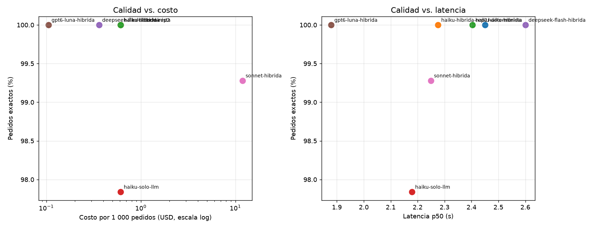

# Comparación de alternativas

Conjunto: `todos`. Métricas = proporción de casos (0–1).

| nombre | modelo | estrategia | n_casos | errores | pedido_exacto | estado_correcto | lineas_correctas | montos_correctos | total_correcto | fecha_correcta | motivos_correctos | pendientes_correctos | sustituciones_correctas | lineas_f1 | contrato_valido | mensaje_coherente | latencia_p50_s | latencia_p95_s | costo_por_1000_pedidos_usd | costo_total_usd |
|---|---|---|---|---|---|---|---|---|---|---|---|---|---|---|---|---|---|---|---|---|
| haiku-hibrida | anthropic/claude-haiku-5.5 | hibrida | 139 | 0 | 1.000 | 1.000 | 1.000 | 1.000 | 1.000 | 1.000 | 1.000 | 1.000 | 1.000 | 1.000 | 1.000 | 1.000 | 2.450 | 4.419 | 0.611 | 0.085 |
| haiku-hibrida-rep2 | anthropic/claude-haiku-5.5 | hibrida | 139 | 0 | 1.000 | 1.000 | 1.000 | 1.000 | 1.000 | 1.000 | 1.000 | 1.000 | 1.000 | 1.000 | 1.000 | 1.000 | 2.276 | 3.520 | 0.611 | 0.085 |
| haiku-determinista | anthropic/claude-haiku-5.5 | determinista | 139 | 0 | 1.000 | 1.000 | 1.000 | 1.000 | 1.000 | 1.000 | 1.000 | 1.000 | 1.000 | 1.000 | 1.000 | 1.000 | 2.403 | 4.279 | 0.611 | 0.085 |
| haiku-solo-llm | anthropic/claude-haiku-5.5 | llm | 139 | 0 | 0.978 | 0.993 | 0.993 | 0.993 | 0.993 | 1.000 | 0.993 | 0.978 | 1.000 | 0.999 | 1.000 | 1.000 | 2.179 | 3.651 | 0.611 | 0.085 |
| deepseek-flash-hibrida | deepseek/deepseek-v4.1-flash | hibrida | 139 | 0 | 1.000 | 1.000 | 1.000 | 1.000 | 1.000 | 1.000 | 1.000 | 1.000 | 1.000 | 1.000 | 1.000 | 1.000 | 2.600 | 5.915 | 0.361 | 0.050 |
| gpt6-luna-hibrida | openai/gpt-6-luna | hibrida | 139 | 0 | 1.000 | 1.000 | 1.000 | 1.000 | 1.000 | 1.000 | 1.000 | 1.000 | 1.000 | 1.000 | 1.000 | 1.000 | 1.879 | 5.395 | 0.105 | 0.015 |
| sonnet-hibrida | anthropic/claude-sonnet-5.5 | hibrida | 139 | 1 | 0.993 | 0.993 | 0.993 | 0.993 | 0.993 | 0.993 | 0.993 | 0.993 | 0.993 | 0.993 | 0.993 | 0.993 | 2.249 | 4.100 | 11.9 | 1.654 |

## Pedidos exactos por tipo de caso

| tipo | haiku-hibrida | haiku-hibrida-rep2 | haiku-determinista | haiku-solo-llm | deepseek-flash-hibrida | gpt6-luna-hibrida | sonnet-hibrida |
|---|---|---|---|---|---|---|---|
| dev:agotado | 6/6 | 6/6 | 6/6 | 6/6 | 6/6 | 6/6 | 6/6 |
| dev:ambiguo | 7/7 | 7/7 | 7/7 | 5/7 | 7/7 | 7/7 | 7/7 |
| dev:audio | 3/3 | 3/3 | 3/3 | 3/3 | 3/3 | 3/3 | 3/3 |
| dev:correccion | 7/7 | 7/7 | 7/7 | 7/7 | 7/7 | 7/7 | 7/7 |
| dev:credito | 5/5 | 5/5 | 5/5 | 5/5 | 5/5 | 5/5 | 5/5 |
| dev:fuera_de_alcance | 5/5 | 5/5 | 5/5 | 5/5 | 5/5 | 5/5 | 5/5 |
| dev:habitual | 8/8 | 8/8 | 8/8 | 8/8 | 8/8 | 8/8 | 8/8 |
| dev:no_existe | 4/4 | 4/4 | 4/4 | 4/4 | 4/4 | 4/4 | 4/4 |
| dev:simple | 19/19 | 19/19 | 19/19 | 19/19 | 19/19 | 19/19 | 19/19 |
| dev:sin_cantidad | 4/4 | 4/4 | 4/4 | 4/4 | 4/4 | 4/4 | 4/4 |
| dev:unidades | 9/9 | 9/9 | 9/9 | 9/9 | 9/9 | 9/9 | 9/9 |
| dev:varios_mensajes | 7/7 | 7/7 | 7/7 | 7/7 | 7/7 | 7/7 | 7/7 |
| propio:agotado | 1/1 | 1/1 | 1/1 | 1/1 | 1/1 | 1/1 | 1/1 |
| propio:ambiguo | 3/3 | 3/3 | 3/3 | 3/3 | 3/3 | 3/3 | 3/3 |
| propio:cantidad | 13/13 | 13/13 | 13/13 | 12/13 | 13/13 | 13/13 | 13/13 |
| propio:correccion | 8/8 | 8/8 | 8/8 | 8/8 | 8/8 | 8/8 | 7/8 |
| propio:credito | 3/3 | 3/3 | 3/3 | 3/3 | 3/3 | 3/3 | 3/3 |
| propio:fecha | 4/4 | 4/4 | 4/4 | 4/4 | 4/4 | 4/4 | 4/4 |
| propio:fuera_de_alcance | 5/5 | 5/5 | 5/5 | 5/5 | 5/5 | 5/5 | 5/5 |
| propio:habitual | 5/5 | 5/5 | 5/5 | 5/5 | 5/5 | 5/5 | 5/5 |
| propio:inyeccion | 7/7 | 7/7 | 7/7 | 7/7 | 7/7 | 7/7 | 7/7 |
| propio:no_existe | 2/2 | 2/2 | 2/2 | 2/2 | 2/2 | 2/2 | 2/2 |
| propio:varios_mensajes | 4/4 | 4/4 | 4/4 | 4/4 | 4/4 | 4/4 | 4/4 |
